<div align="center">

# 👻 AgentForge V2 · Phantom Hunter

### Every data centre announced is a promise. This tells you which ones are real.

**An agentic intelligence engine that reads the news on 451 data-centre projects across India, Malaysia, Singapore and Indonesia, verifies every claim against its source, maps who actually has power, and then tests its own predictions against what happened, including the ones it got wrong.**


<br/>

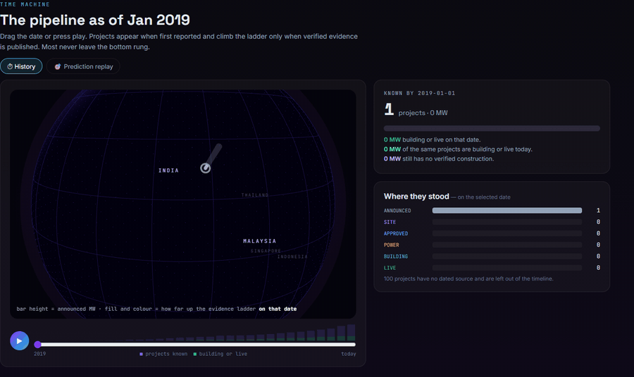

*The Time machine. Projects appear when first reported and climb the evidence ladder only when verified evidence is published. Most never leave the bottom rung.*

</div>

---

## ⚡ The numbers

| | |
|---|---|
| 📰 **Articles read** | **2,678** news articles from Bing News, Google News, GDELT and Firecrawl (783 in full text) |
| 🏗️ **Projects resolved** | **451** projects (India 285 · Malaysia 113 · Indonesia 45 · Singapore 8), de-duplicated from 1,585 verified mentions |
| ⚡ **Announced → likely** | **78.2 GW announced → 31.3 GW reality-weighted (40%)**. About 47 GW is phantom risk |
| 🔌 **Secured power** | Only **13%** of announced capacity is operating or has a verified grid agreement |
| ✅ **Fact-checker** | **98.5%** of 5,301 planted errors caught, **0** false rejections in 2,392 untouched fields |
| 🎯 **Recall** | **89%** of 36 pipeline sites from four published lists found |
| 📉 **Backtest** | 426 cases replayed at four cutoffs. Calibrated once construction starts; **no predictive skill before it.** [Why that's the most useful result →](#-the-honest-part) |

---

## 🖥️ The control room

<table>
<tr>
<td width="50%">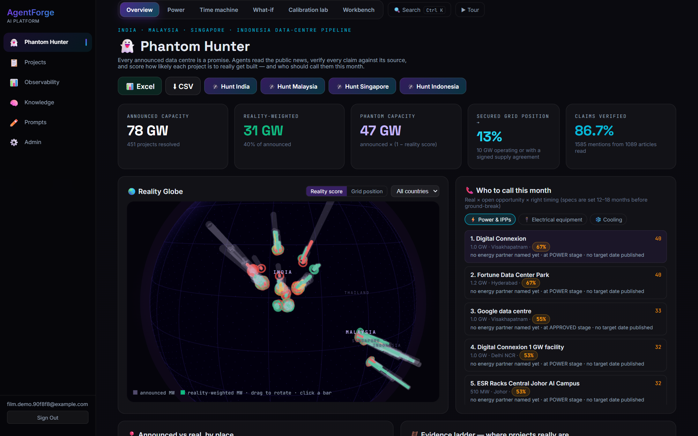<br/><b>Overview.</b> Announced vs real, the 3D Reality Globe and who to call this month.</td>
<td width="50%">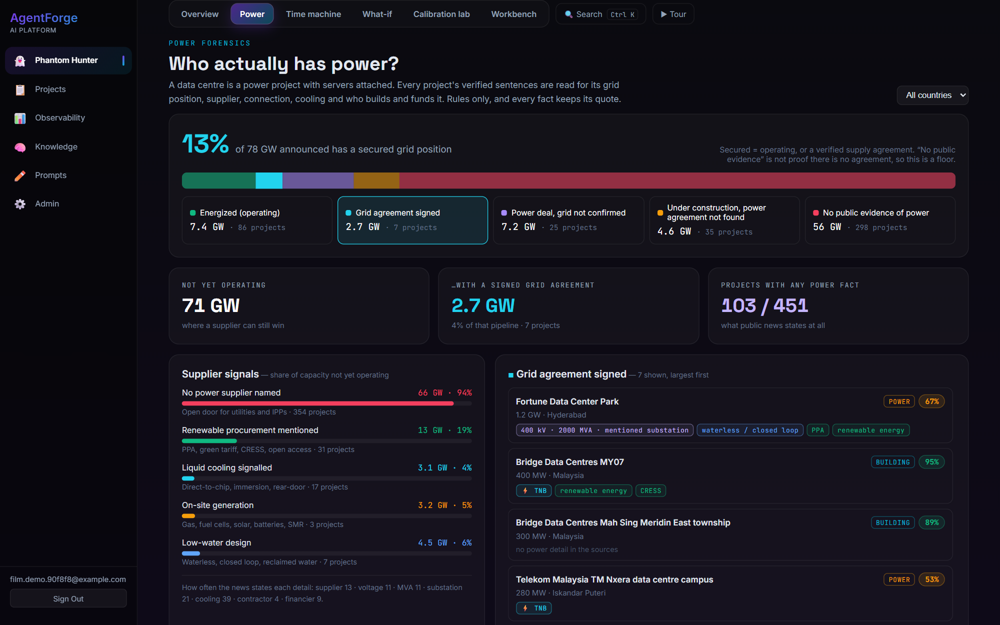<br/><b>Power.</b> Secured vs unsecured capacity, the six grid positions as a filter, supplier signals.</td>
</tr>
<tr>
<td>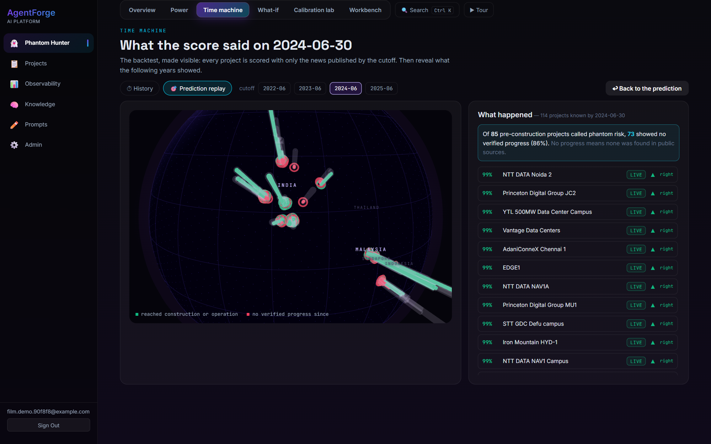<br/><b>Prediction replay.</b> Stand at a past cutoff, see what the score said using only the news published by then, then reveal what happened.</td>
<td>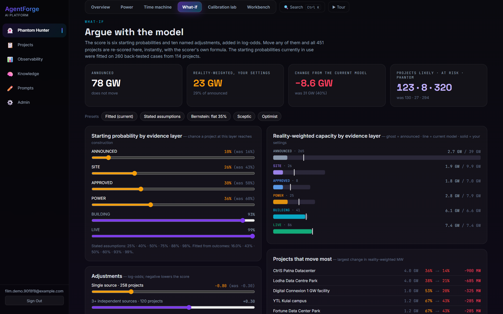<br/><b>What-if.</b> Sixteen sliders over every prior and adjustment re-score every project in the browser, with the scorer's own formula.</td>
</tr>
<tr>
<td>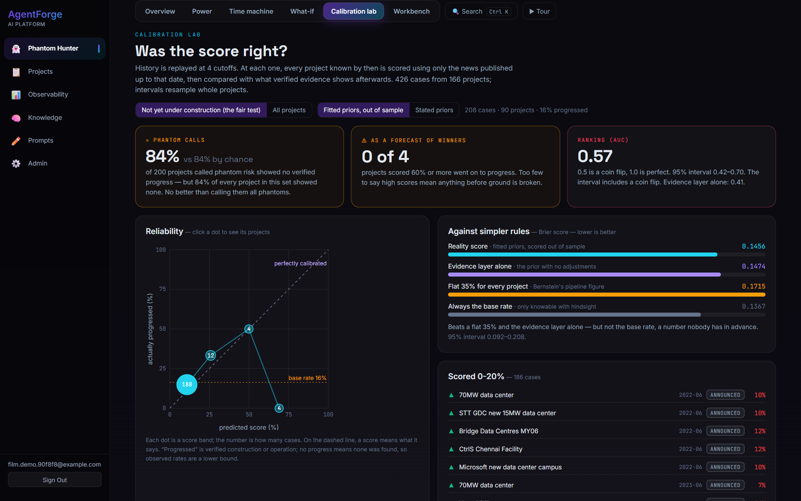<br/><b>Calibration lab.</b> Reliability diagram, the score against three simpler rules, and every claim compared with the base rate.</td>
<td>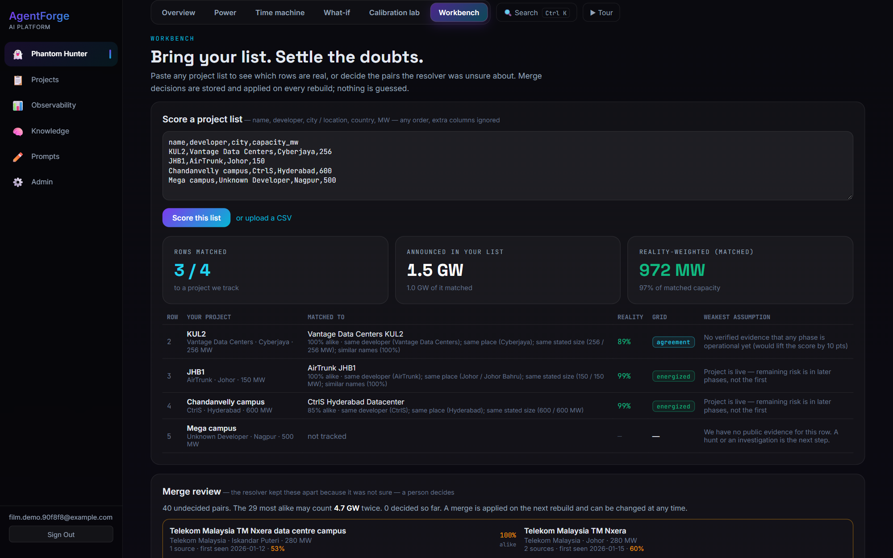<br/><b>Workbench.</b> Paste anyone's project list: each row is matched and scored. Look-alike pairs go to a human merge queue.</td>
</tr>
<tr>
<td>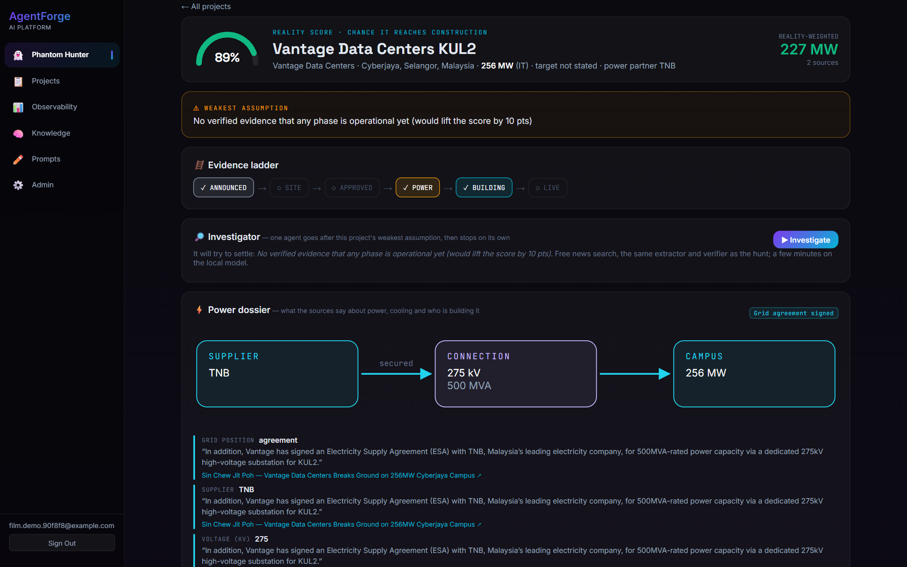<br/><b>Project dossier.</b> Evidence ladder, the Investigator agent, and a power diagram: supplier → connection → campus, every fact with its quote.</td>
<td>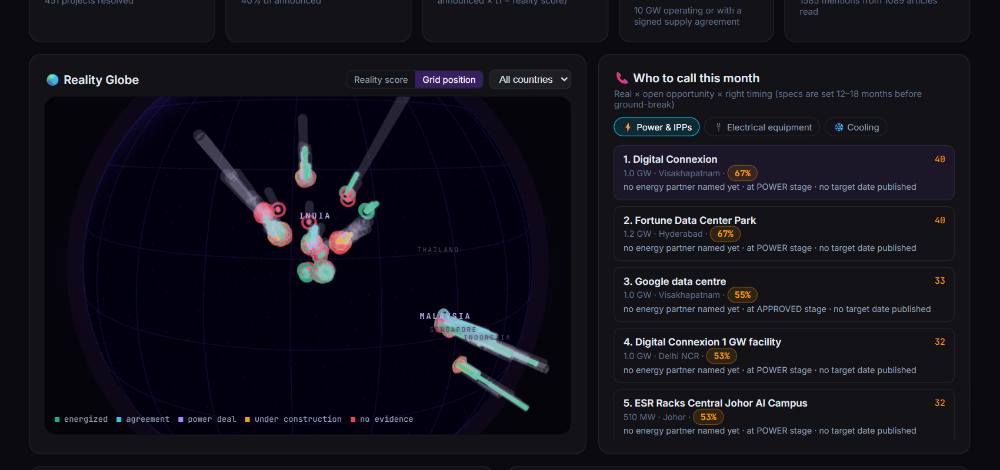<br/><b>Globe by grid position.</b> Energized, agreement signed, power deal, under construction, no evidence.</td>
</tr>
</table>

<div align="center">
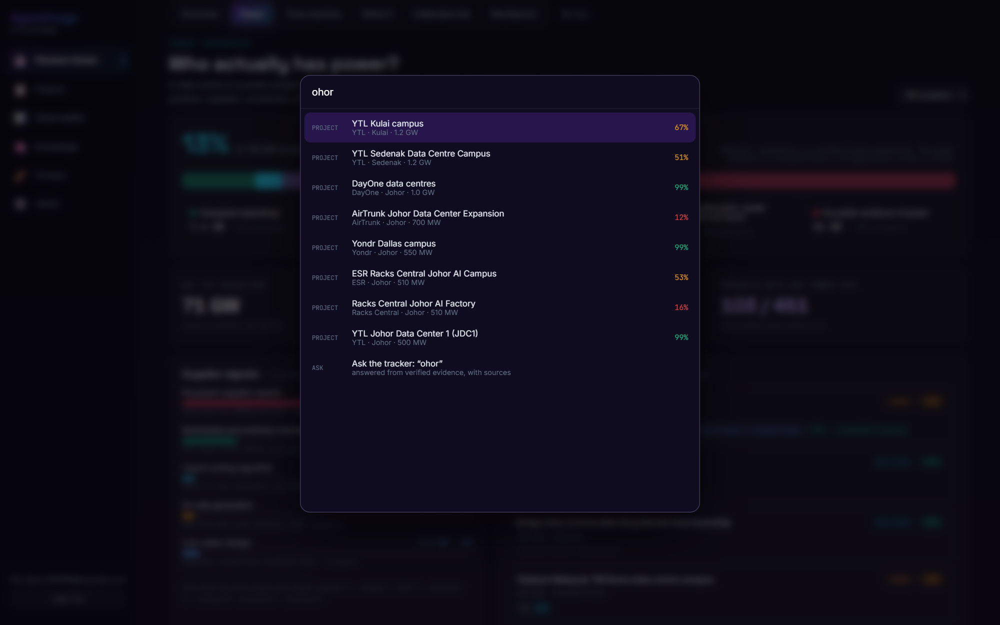<br/>
<b>Ctrl + K</b>: jump to any project or view, or ask the tracker a question and get a cited answer. A <b>▶ Tour</b> button walks a first-time reviewer through every view in 90 seconds.
</div>

---

## 🧠 How it works

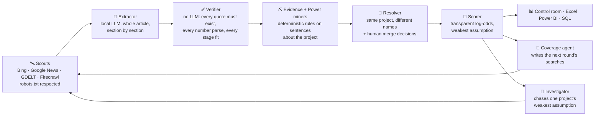

**The LLM proposes, the verifier decides.** A 7B model on a laptop extracts projects, capacities and stage events. Every claim is then checked by code: does the quote exist in the article, does it describe that stage, is it about *this* project and not another one in the same article? Unsupported claims are dropped.

**The score is a glass box.** `logit(p) = logit(prior[evidence layer]) + Σ named adjustments`. Every term is shown in the UI. The priors were stated assumptions anchored to public figures (Bernstein, Capgemini, Sightline) and were then re-fitted on back-tested outcomes, with shrinkage.

**Power is a first-class field.** A data centre is a power project with servers attached. Each project carries a dossier: grid position, supplier, kV and MVA, substation, on-site generation, renewable procurement, cooling, contractor and financier, each fact with the sentence it came from.

**Agents that decide.** The hunt is a LangGraph loop: plan → scout → extract → resolve → coverage. The coverage agent reads the gaps and writes the next round's queries. The Investigator takes one project, picks the search that would settle its weakest assumption, widens it after a miss, re-scores and stops on its own, streaming every step live.

---

## 🎯 The honest part

Most trackers publish a confidence score. Very few test it. This one does, and publishes the result.

History is replayed at four cutoffs (mid-2022 to mid-2025). At each one, every project is scored using **only the news published by then**, then compared with what verified evidence shows afterwards.

| What was tested | Result |
|---|---|
| Projects already under construction when scored | ✅ **Well calibrated**: high scores come true. The score sizes the real pipeline. |
| Projects not yet under construction (the fair test: 208 cases, out of sample) | ❌ **AUC 0.57, interval 0.42–0.70: not distinguishable from a coin flip.** Brier 0.146: better than a flat 35% (0.172), worse than the hindsight base rate (0.137). |
| "Phantom risk" calls before construction | 84% right, but 84% of all such projects never progressed. **No better than chance.** |
| Re-fitting the priors on outcomes | Did not help out of sample (fitted 0.146 vs stated 0.143). |

**What it means.** The news published before ground is broken does not carry the signal that separates real projects from talk. No amount of model tuning fixes that. The signal lives in **filings**: supply agreements, environmental clearances and land records. That is the next data source, and the backtest harness is ready to measure whether it works.

An earlier version reported "Brier 0.097, twice as good as the base rate". That number came from too few cases and an easy subset. As the backtest grew (233 → 333 → 426 cases) the pre-construction ranking moved 0.59 → 0.47 → 0.57, every time with an interval that includes a coin flip. The noise is the finding. Full detail is in [`PHANTOM_EVAL.md`](PHANTOM_EVAL.md) §6.

---

## 📊 Analytics pack: Excel · Google Sheets · Power BI · SQL

<div align="center">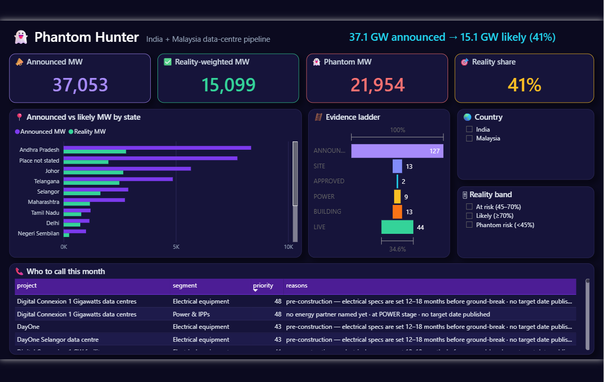</div>

| | |
|---|---|
| 📗 [`analytics/PhantomHunter.xlsx`](analytics/PhantomHunter.xlsx) | KPIs as live formulas, filterable tables (projects, evidence, power facts, developers, who to call), SUMIFS analysis and native charts. Opens in Google Sheets too. |
| 🟨 [`analytics/powerbi/`](analytics/powerbi) | PBIP report: theme, DAX measures and the build script |
| 🗄️ [`analytics/sql/`](analytics/sql) · [`SQL_RESULTS.md`](analytics/SQL_RESULTS.md) | 11 readable queries run against the live database: window functions, partitioned shares, funnels |
| 📈 [`analytics/ANALYSIS.md`](analytics/ANALYSIS.md) | Findings, power forensics, developer track records and 6 charts, regenerated from the data |

<p align="center">
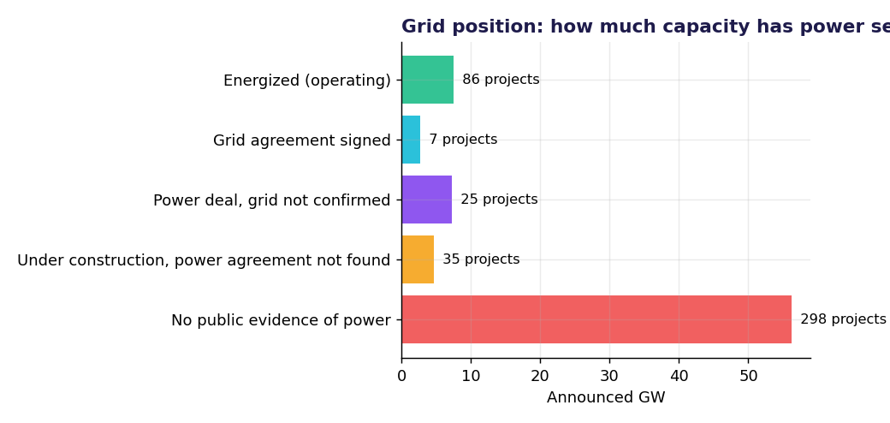 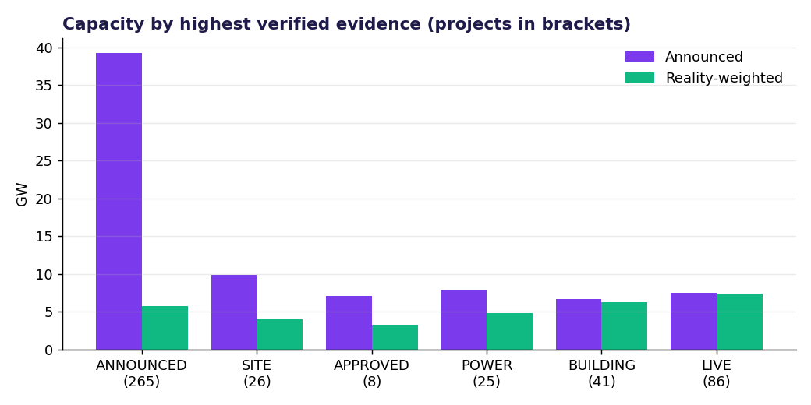
</p>

---

## 🧪 Evaluation, not assertion

| Test | What it proves | Result |
|---|---|---|
| **Planted errors** | Real mentions corrupted field by field, re-verified | 98.5% caught, 0 false rejections |
| **Evidence audit** | Random verified quotes graded: right stage, right project? | 62.5% → **77.5%** on a fresh sample *(first-pass AI labels; human relabelling pending)* |
| **Recall** | 42 sites from Wikipedia, Black Ridge, Mordor, DCK | **89%** of pipeline sites found |
| **Coverage-agent ablation** | What the agentic loop adds over fixed queries | +29 projects from 32 self-written queries |
| **Calibration backtest** | Does the score mean what it says? | See [The honest part](#-the-honest-part) |
| **Unit tests** | Verifier, resolver, power rules, merge queue, import, backtest maths | **202 passing** (no LLM, no network) |

Every number on this page is regenerated by a script: `python -m app.phantom.evaluate`, `python -m app.phantom.analysis`, `python -m app.phantom.backtest`.

---

## 🚀 Quick start

### See it in 2 minutes: no API key, no GPU

```bash
git clone https://github.com/rajmodi262/AgentForge_V2.git
cd AgentForge_V2/backend
python -m venv venv && venv\Scripts\activate          # macOS/Linux: source venv/bin/activate
pip install -r requirements.txt
uvicorn app.main:app --port 8000                       # first start loads the real dataset automatically
```

```bash
cd AgentForge_V2/frontend && npm install && npm run dev  # open http://localhost:5180/phantom and register
```

On first start the backend fills an empty database from `backend/seed/phantom_seed.json.gz`: 451 projects, 2,678 article records (metadata only, no article bodies), 1,585 verified mentions and 1,404 evidence quotes. Turn it off with `PHANTOM_AUTO_SEED=false`.

### Collect fresh data

Install [Ollama](https://ollama.com) and pull `qwen2.5:7b`, then press **Hunt** on the overview, or use **Investigate** on any project. An optional free [Firecrawl](https://firecrawl.dev) key (`FIRECRAWL_API_KEY` in `backend/.env`) lets the scouts read pages a plain fetch can't, still respecting robots.txt, with a hard credit cap per run. Phantom Hunter refuses to extract in mock mode, so demo output never becomes evidence.

| Service | URL |
|---|---|
| 🌐 App | http://localhost:5180/phantom |
| ⚡ API | http://localhost:8000 |
| 📚 API docs | http://localhost:8000/docs |

---

## 🛠 Tech stack

| Layer | Tools |
|---|---|
| **Agents** | LangGraph state machines, Pydantic structured output, a local LLM via Ollama, with Groq / Gemini / Claude as alternative providers |
| **Data** | httpx scouts, trafilatura, Firecrawl, rapidfuzz entity resolution, an offline gazetteer |
| **Backend** | FastAPI, SQLAlchemy, SQLite / PostgreSQL, WebSockets, JWT auth, rate limiting |
| **Frontend** | React 19, TypeScript, Three.js / react-three-fiber, framer-motion, Vite |
| **Analytics** | openpyxl, matplotlib, SQL, Power BI (PBIP + DAX) |
| **Quality** | pytest (202), CodeQL, Dependabot, Playwright |

---

## 📂 Where things are

```
backend/app/phantom/
  sources.py     scouts: feeds, polite fetching, Firecrawl fallback
  extract.py     LLM extraction + deterministic evidence miner
  verify.py      the fact-checker: no LLM
  power.py       power forensics: grid position, supplier, cooling, ecosystem
  resolve.py     entity resolution + the subject check
  merge.py       human merge-review queue
  score.py       log-odds reality score, weakest assumption, who to call
  backtest.py    four-cutoff calibration backtest, re-fitting, cross-validation
  investigate.py the Investigator agent
  importer.py    score any CSV project list
  track.py       developer track records
  pipeline.py    the LangGraph hunt
frontend/src/pages/Phantom*.tsx   the control room
analytics/                        Excel, Power BI, SQL, charts
PHANTOM_HUNTER.md                 design write-up and interview Q&A
PHANTOM_EVAL.md                   every evaluation, regenerated from data
```

---

## 🤖 The AgentForge engine underneath

Phantom Hunter is built on **AgentForge**, a multi-agent engine where seven specialist agents (CEO, Research, Marketing, Developer, Finance, Analytics, Operations) turn a startup idea into a blueprint, debate it in a Board Meeting, and hand it to a Chief Synthesizer. The engine provides the agent framework, multi-provider LLM service, structured output with retries, WebSocket streaming, an MCP server and the 3D UI. Its own evaluation harness ([`backend/eval/`](backend/eval)) measured the seven-agent pipeline against a single strong prompt, and it reported a tie. That result is what pushed the project towards real data, where agents can do what a single prompt cannot.

---

## ⚠️ Limitations

- **The score is a measuring tool, not a forecaster.** It cannot yet predict which pre-construction projects will be built (see [The honest part](#-the-honest-part)).
- **Public news only.** It names a power supplier for just 14 of 451 projects. A filings scout is built (`targeted.py filings`) and waits on search credits.
- **Singapore and Indonesia are thin.** One free-feed hunt each: 8 and 45 projects. Singapore's figure is genuinely small (new capacity was frozen for years) and only counts projects the text itself places there, not every "Singapore-based" developer.
- **57% of projects rest on a single source.** Announced capacity is an upper bound; a few duplicates survive by design for human review.
- **The evidence audit is AI-labelled** until two people regrade it. The samples are in the repo.

---

## 📄 License

MIT. See [LICENSE](LICENSE).

<div align="center">

**Built by [Raj Modi](https://github.com/rajmodi262)**

*If this changed how you read a data-centre announcement, leave a ⭐*

</div>
