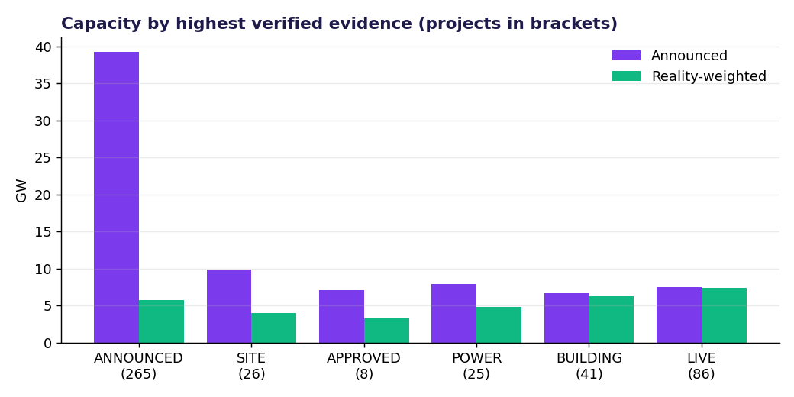
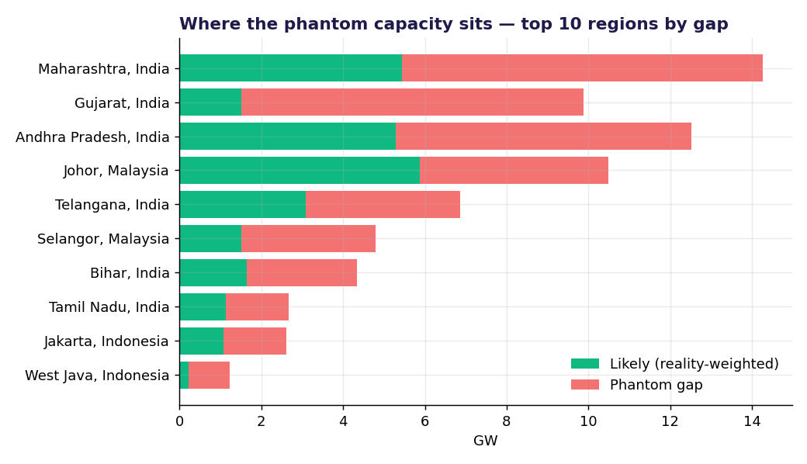
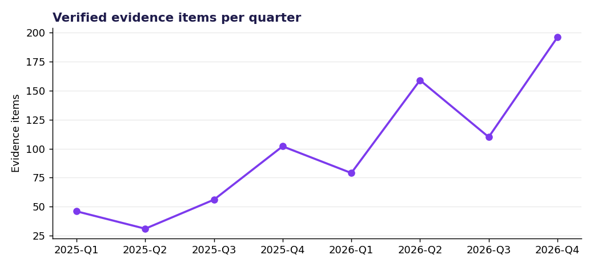

# Phantom Hunter — data analysis

Generated by `python -m app.phantom.analysis` on 2026-11-21. Every number is computed from the current database, so re-running after a new hunt updates the findings.

## Key findings

1. **Only 40% of announced capacity looks real.** 319 of 451 projects state a capacity: 78.2 GW announced, 31.3 GW reality-weighted. The other 46.9 GW is phantom risk.
2. **Most capacity is still paper.** 56.2 GW (72%) sits at ANNOUNCED / SITE / APPROVED; only 14.1 GW (18%) has verified BUILDING or LIVE evidence.
3. **The biggest gap is Maharashtra, India**: 14.3 GW announced across 72 projects with a stated capacity, 5.4 GW likely — a 8.8 GW gap.
4. **The pipeline is concentrated.** The top 5 developers account for 39% of announced MW. Highest reality share among the big names: Digital Connexion (61%), NTT DATA (54%), DayOne (53%). Lowest: AdaniConneX (24%), TCS HyperVault (32%), Google (35%).
5. **Corroboration matters.** 258 projects (57%) rest on a single source and average 27%; projects with 5+ sources average 75%. The single biggest lever for confidence is a second independent source.
6. **Publishers block bots.** 11% of verified evidence comes from headlines/summaries, not full articles — which is why the scorer applies a headline-only penalty and why permit / utility filings are the next data source.
7. **Momentum is rising.** Verified evidence went from 110 items in 2026-Q3 to 196 in 2026-Q4 (the latest quarter may still be partial).
8. **Sales opportunity.** 16 projects are likely enough (≥45%), at least 50 MW, pre-construction and have **no power partner named** — 4.9 GW of reality-weighted demand an IPP could still bid for.

## Power forensics

A data centre is a power project with servers attached. Every project's verified sentences are also read for its **grid position**, supplier, connection, on-site generation, cooling and who is building and funding it (`app/phantom/power.py`; rules only, every fact keeps its quote).

**10.2 GW of 78.2 GW announced (13%) has a secured grid position** — operating, or with a verified supply agreement. Of the 70.7 GW that is not yet operating, a signed grid agreement was found for **2.7 GW (4%)** across 7 projects.

| Grid position | Projects | Announced | Share |
|---|---|---|---|
| Energized (operating) | 86 | 7.4 GW | 10% |
| Grid agreement signed | 7 | 2.7 GW | 3% |
| Power deal, grid not confirmed | 25 | 7.2 GW | 9% |
| Under construction, power agreement not found | 35 | 4.6 GW | 6% |
| No public evidence of power | 298 | 56.2 GW | 72% |

Signals across the pipeline (projects not yet operating):

| Signal | Projects | Capacity | Share of pipeline |
|---|---|---|---|
| Grid agreement signed (pipeline) | 7 | 2.7 GW | 4% |
| No utility or power supplier named | 354 | 66.4 GW | 94% |
| Renewable procurement mentioned (PPA, green tariff, CRESS, open access) | 31 | 13.4 GW | 19% |
| Liquid cooling (direct-to-chip, immersion, rear-door) | 17 | 3.1 GW | 4% |
| On-site / behind-the-meter generation | 3 | 3.2 GW | 5% |
| Low-water or reclaimed-water design | 2 | 1.7 GW | 2% |

Projects with a verified grid agreement:

| Project | Capacity | Supplier | Connection |
|---|---|---|---|
| Fortune Data Center Park | 1200 MW | — | 400 kV · 2000 MVA · mentioned substation |
| Bridge Data Centres MY07 | 400 MW | TNB | — |
| Bridge Data Centres Mah Sing Meridin East township | 300 MW | TNB | — |
| Telekom Malaysia TM Nxera data centre campus | 280 MW | TNB | — |
| Telekom Malaysia TM Nxera | 280 MW | TNB | — |
| Vantage Data Centers KUL2 | 256 MW | TNB | 275 kV · 500 MVA |
| CtrlS Hyderabad DC3Colocation | 0 MW | — | — |

How much of this the news actually states — of 451 projects: supplier named 13, connection voltage 11, contracted MVA 11, substation 21, cooling design 39, renewable procurement 46, on-site generation 6, rack density 2, PUE 3, contractor 4, financier 9. **103 projects (23%) have at least one power fact.**

The finding is the gap itself: public news names a power supplier for a small minority of projects, and a signed grid agreement for fewer still. For a supplier, the projects in *No public evidence* with a credible developer are the open opportunities; for an analyst, this is the field that filings (supply agreements, environmental clearances) would fill.

## Developer track records

Who builds what they announce? *Judged* counts only projects first reported 24+ months ago — a recent announcement cannot count against anyone — and *build rate* is the share of those with verified construction or operation (shown from 3 judged projects). *Months to ground* is the median wait from first report to first verified construction evidence.

| Developer | Projects | Announced | Live | Building | Judged | Built | Build rate | Months to ground | Secured grid |
|---|---|---|---|---|---|---|---|---|---|
| CtrlS | 31 | 7.7 GW | 8 | 4 | 7 | 6 | 86% | 9.3 | 1.2 GW |
| Reliance Jio | 15 | 7.5 GW | 0 | 1 | 2 | 0 | — | — | — |
| Google | 20 | 6.3 GW | 1 | 8 | 1 | 0 | — | — | 28 MW |
| YTL | 13 | 4.8 GW | 1 | 0 | 5 | 1 | 20% | — | 500 MW |
| AdaniConneX | 14 | 4.5 GW | 3 | 0 | 4 | 1 | 25% | — | 197 MW |
| DayOne | 5 | 3.1 GW | 1 | 1 | 0 | 0 | — | 16.1 | 1.0 GW |
| Sify | 13 | 3.0 GW | 3 | 2 | 3 | 0 | 0% | — | 100 MW |
| Princeton Digital Group | 30 | 2.9 GW | 6 | 3 | 16 | 4 | 25% | 8.3 | 527 MW |
| Digital Connexion | 8 | 2.3 GW | 2 | 1 | 3 | 1 | 33% | — | 120 MW |
| NTT DATA | 20 | 2.2 GW | 14 | 1 | 12 | 10 | 83% | 29.7 | 968 MW |
| AirTrunk | 10 | 1.7 GW | 2 | 0 | 4 | 2 | 50% | 18.3 | 200 MW |
| STT GDC | 24 | 1.2 GW | 7 | 4 | 6 | 4 | 67% | 5.7 | 275 MW |
| Fortune Hospitality | 3 | 1.2 GW | 0 | 0 | 0 | 0 | — | — | 1.2 GW |
| Digital Edge | 6 | 1.1 GW | 1 | 0 | 4 | 1 | 25% | 8.8 | 23 MW |
| Bridge Data Centres | 6 | 1.1 GW | 1 | 2 | 4 | 2 | 50% | 30.0 | 800 MW |

The record is shown, not scored: the backtest could test "has built two or more other projects" on only 6 cases (4 progressed, against a 13% base rate) — encouraging, and far too few to tune a weight on.

## Charts

### Capacity by evidence stage

### Phantom gap by region

### Developers: announced vs real

### Reality score vs number of sources

### Grid position

### Evidence momentum

## Score distribution

| Band | Projects |
|---|---|
| At risk (45–70%) | 27 |
| Likely (≥70%) | 130 |
| Phantom risk (<45%) | 294 |

Median reality score: 17%.

## Caveats

- **Calibration.** The layer priors are fitted from a backtest and cross-validated (`PHANTOM_EVAL.md` §6). It validates the score as a filter for phantom projects; it does not yet show the score can pick winners before construction starts.
- **Recall.** Against 42 sites from four published lists the pipeline finds most large projects (`PHANTOM_EVAL.md` §5); small projects that never make the news are still invisible.
- **Power facts are what public sources say.** *No public evidence* is not proof that a project has no power agreement — supply agreements are often never announced. Filings are the next source to add.
- A few projects may appear twice when the resolver was not confident enough to merge them (by design), so announced GW is an upper bound.
