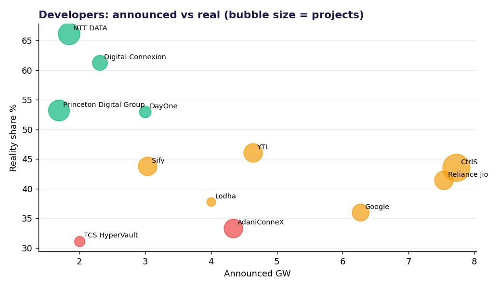
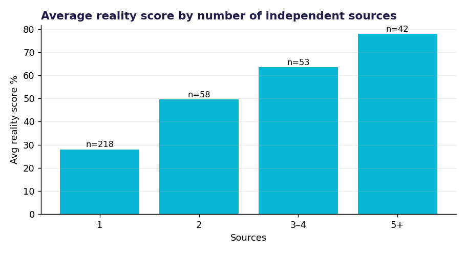
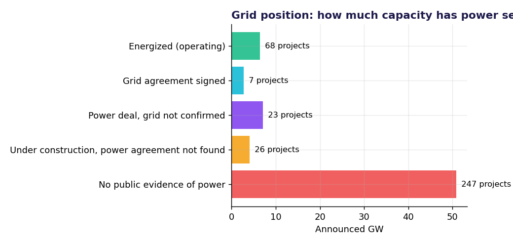

# Phantom Hunter — data analysis

Generated by `python -m app.phantom.analysis` on 2026-11-15. Every number is computed from the current database, so re-running after a new hunt updates the findings.

## Key findings

1. **Only 42% of announced capacity looks real.** 260 of 371 projects state a capacity: 71.1 GW announced, 29.9 GW reality-weighted. The other 41.2 GW is phantom risk.
2. **Most capacity is still paper.** 50.8 GW (71%) sits at ANNOUNCED / SITE / APPROVED; only 12.7 GW (18%) has verified BUILDING or LIVE evidence.
3. **The biggest gap is Gujarat, India**: 9.9 GW announced across 10 projects with a stated capacity, 1.8 GW likely — a 8.1 GW gap.
4. **The pipeline is concentrated.** The top 5 developers account for 43% of announced MW. Highest reality share among the big names: NTT DATA (66%), Digital Connexion (61%), Princeton Digital Group (53%). Lowest: TCS HyperVault (31%), AdaniConneX (33%).
5. **Corroboration matters.** 218 projects (59%) rest on a single source and average 28%; projects with 5+ sources average 78%. The single biggest lever for confidence is a second independent source.
6. **Publishers block bots.** 5% of verified evidence comes from headlines/summaries, not full articles — which is why the scorer applies a headline-only penalty and why permit / utility filings are the next data source.
7. **Momentum is rising.** Verified evidence went from 96 items in 2026-Q3 to 169 in 2026-Q4 (the latest quarter may still be partial).
8. **Sales opportunity.** 16 projects are likely enough (≥45%), at least 50 MW, pre-construction and have **no power partner named** — 5.3 GW of reality-weighted demand an IPP could still bid for.

## Power forensics

A data centre is a power project with servers attached. Every project's verified sentences are also read for its **grid position**, supplier, connection, on-site generation, cooling and who is building and funding it (`app/phantom/power.py`; rules only, every fact keeps its quote).

**9.1 GW of 71.1 GW announced (13%) has a secured grid position** — operating, or with a verified supply agreement. Of the 64.7 GW that is not yet operating, a signed grid agreement was found for **2.7 GW (4%)** across 7 projects.

| Grid position | Projects | Announced | Share |
|---|---|---|---|
| Energized (operating) | 68 | 6.4 GW | 9% |
| Grid agreement signed | 7 | 2.7 GW | 4% |
| Power deal, grid not confirmed | 23 | 7.1 GW | 10% |
| Under construction, power agreement not found | 26 | 4.1 GW | 6% |
| No public evidence of power | 247 | 50.8 GW | 71% |

Signals across the pipeline (projects not yet operating):

| Signal | Projects | Capacity | Share of pipeline |
|---|---|---|---|
| Grid agreement signed (pipeline) | 7 | 2.7 GW | 4% |
| No utility or power supplier named | 292 | 60.3 GW | 93% |
| Renewable procurement mentioned (PPA, green tariff, CRESS, open access) | 24 | 12.5 GW | 19% |
| Liquid cooling (direct-to-chip, immersion, rear-door) | 13 | 2.7 GW | 4% |
| On-site / behind-the-meter generation | 2 | 3.0 GW | 5% |
| Low-water or reclaimed-water design | 2 | 1.7 GW | 3% |

Projects with a verified grid agreement:

| Project | Capacity | Supplier | Connection |
|---|---|---|---|
| Fortune Data Center Park | 1200 MW | — | 400 kV · 2000 MVA · mentioned substation |
| Bridge Data Centres MY07 | 400 MW | TNB | — |
| Bridge Data Centres Mah Sing Meridin East township | 300 MW | TNB | — |
| Telekom Malaysia TM Nxera data centre campus | 280 MW | TNB | — |
| Telekom Malaysia TM Nxera AI-Ready Data Center Campus | 280 MW | TNB | — |
| Vantage Data Centers KUL2 | 256 MW | TNB | 275 kV · 500 MVA |
| CtrlS Hyderabad DC3Colocation | 0 MW | — | — |

How much of this the news actually states — of 371 projects: supplier named 13, connection voltage 10, contracted MVA 11, substation 19, cooling design 31, renewable procurement 36, on-site generation 4, rack density 2, PUE 2, contractor 3, financier 7. **84 projects (23%) have at least one power fact.**

The finding is the gap itself: public news names a power supplier for a small minority of projects, and a signed grid agreement for fewer still. For a supplier, the projects in *No public evidence* with a credible developer are the open opportunities; for an analyst, this is the field that filings (supply agreements, environmental clearances) would fill.

## Developer track records

Who builds what they announce? *Judged* counts only projects first reported 24+ months ago — a recent announcement cannot count against anyone — and *build rate* is the share of those with verified construction or operation (shown from 3 judged projects). *Months to ground* is the median wait from first report to first verified construction evidence.

| Developer | Projects | Announced | Live | Building | Judged | Built | Build rate | Months to ground | Secured grid |
|---|---|---|---|---|---|---|---|---|---|
| CtrlS | 31 | 7.7 GW | 8 | 4 | 7 | 6 | 86% | 9.3 | 1.2 GW |
| Reliance Jio | 14 | 7.5 GW | 0 | 1 | 1 | 0 | — | — | — |
| Google | 19 | 6.3 GW | 1 | 8 | 0 | 0 | — | — | 28 MW |
| YTL | 13 | 4.6 GW | 1 | 0 | 4 | 1 | 25% | 31.8 | 500 MW |
| AdaniConneX | 13 | 4.3 GW | 3 | 0 | 3 | 1 | 33% | — | 197 MW |
| Sify | 13 | 3.0 GW | 3 | 2 | 3 | 0 | 0% | — | 100 MW |
| DayOne | 3 | 3.0 GW | 1 | 0 | 0 | 0 | — | 16.1 | 1.0 GW |
| Digital Connexion | 8 | 2.3 GW | 2 | 1 | 2 | 1 | — | — | 120 MW |
| NTT DATA | 17 | 1.8 GW | 13 | 0 | 8 | 7 | 88% | 9.8 | 1.1 GW |
| Princeton Digital Group | 18 | 1.7 GW | 5 | 0 | 9 | 3 | 33% | 8.3 | 505 MW |
| AirTrunk | 8 | 1.5 GW | 1 | 0 | 2 | 1 | — | — | 150 MW |
| Fortune Hospitality | 3 | 1.2 GW | 0 | 0 | 0 | 0 | — | — | 1.2 GW |
| Bridge Data Centres | 6 | 1.1 GW | 1 | 2 | 4 | 2 | 50% | 30.0 | 800 MW |
| Yotta | 19 | 1.0 GW | 3 | 1 | 10 | 1 | 10% | 59.9 | 52 MW |
| Gamuda | 3 | 1.0 GW | 0 | 0 | 0 | 0 | — | — | — |

The record is shown, not scored: the backtest could test "has built two or more other projects" on only 6 cases (4 progressed, against a 13% base rate) — encouraging, and far too few to tune a weight on.

## Charts

### Capacity by evidence stage

### Phantom gap by region

### Developers: announced vs real

### Reality score vs number of sources

### Grid position

### Evidence momentum

## Score distribution

| Band | Projects |
|---|---|
| At risk (45–70%) | 25 |
| Likely (≥70%) | 102 |
| Phantom risk (<45%) | 244 |

Median reality score: 21%.

## Caveats

- **Calibration.** The layer priors are fitted from a backtest and cross-validated (`PHANTOM_EVAL.md` §6). It validates the score as a filter for phantom projects; it does not yet show the score can pick winners before construction starts.
- **Recall.** Against 42 sites from four published lists the pipeline finds most large projects (`PHANTOM_EVAL.md` §5); small projects that never make the news are still invisible.
- **Power facts are what public sources say.** *No public evidence* is not proof that a project has no power agreement — supply agreements are often never announced. Filings are the next source to add.
- A few projects may appear twice when the resolver was not confident enough to merge them (by design), so announced GW is an upper bound.
